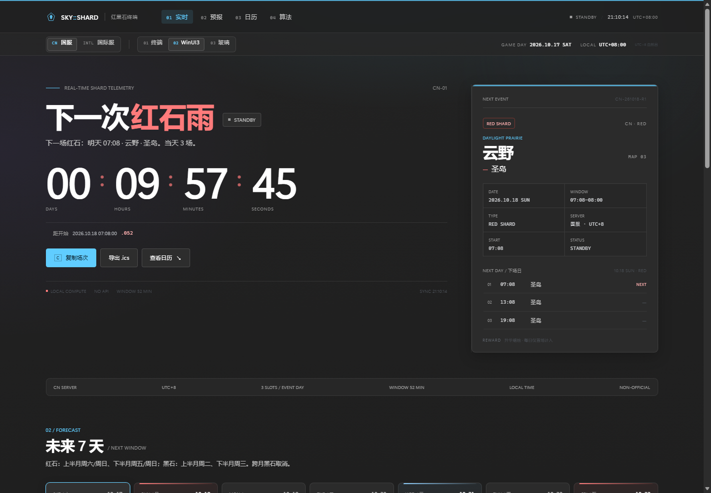

# SKY::SHARD

一个极简、极客风格的光遇红黑石时刻表。支持**国服**与**国际服**（含主机 / PC 等全球服平台），同时计算红石与黑石。纯静态、零依赖，所有时间由本机按确定性规则推导，不请求后端接口。

**在线使用：** <https://yegh2.github.io/sky-shard/>  
**国际服直达：** <https://yegh2.github.io/sky-shard/?server=intl>


## 功能

- 红石 / 黑石的下一次降落实时倒计时（秒级精确，毫秒显示）
- 当前场次、下一场、今日 3 场的完整状态
- 未来 7 天时间轴，红 / 黑石分色
- 可交互月历；红石、黑石、无碎石日均可点击查看
- 一键复制场次；自动复制失败时弹出手动复制窗口
- 导出未来 90 个游戏日的 `.ics` 日历（含提前 10 分钟提醒）
- 国服 / 国际服切换，状态保存在 URL 与 localStorage
- **三套界面风格**：终端 / WinUI 3 / 液态玻璃，随时切换
- 键盘快捷键：`C` 复制下一场、`T` 回到今天、`[` / `]` 切换月份

## 界面风格

风格切换器位于服务器切换器旁边，选择会写入 URL 与 `localStorage`：

- `?theme=terminal` — 默认的黑底终端风格
- `?theme=winui` — WinUI 3 / Fluent 深色，Mica 质感、Segoe UI Variable、Windows 蓝
- `?theme=glass` — 液态玻璃，WebGL 动态背景 + 深色磨砂玻璃层




终端黑石状态：[preview/black.png](preview/black.png) · 移动端：[preview/mobile.png](preview/mobile.png)

两个参考项目分别是 Vue 3 与 Next.js 应用。为了保持本站**零依赖、纯静态、可直接部署 GitHub Pages**，这里没有打包它们的运行时，而是基于其公开视觉规范独立实现了 CSS / WebGL 主题。详细署名与许可证见 [THIRD_PARTY_NOTICES.md](THIRD_PARTY_NOTICES.md)。

## 本地运行

```powershell
python -m http.server 4173
```

打开 <http://127.0.0.1:4173/>，或直接双击 `index.html`（部分浏览器会限制 `file://` 下的剪贴板写入）。

国际服直达：<http://127.0.0.1:4173/?server=intl>

## 时间与日期

- 所有场次按**本地时区**显示，倒计时为绝对时间差。
- 日期按各自服务器的**游戏日**分组：
  - 国服：`UTC+8` 自然日 00:00 切换。
  - 国际服：`America/Los_Angeles` 00:00 切换，界面自动处理美国夏令时。
- 跨本地午夜的场次会标注 `+1`，例如 `00:38+1`。

## 国服规则（UTC+8）

### 红石

- 每月 1–15 日：周六、周日
- 每月 16–31 日：周五、周日
- 场次：周五 `11:08–12:00 / 17:08–18:00 / 23:08–24:00`；周六 `10:08–11:00 / 14:08–15:00 / 22:08–23:00`；周日 `07:08–08:00 / 13:08–14:00 / 19:08–20:00`
- 单场 52 分钟

### 黑石

- 每月 1–15 日：周二
- 每月 16–31 日：周三
- 场次：周二 `09:08–10:00 / 14:08–15:00 / 19:08–20:00`；周三 `09:08–10:00 / 15:08–16:00 / 21:08–22:00`
- 跨月取消：月末周二与月初周三分属不同月份时，该周黑石取消

### 地点

大地图由日期数字除以 5 的余数决定：`0 霞谷 / 1 暮土 / 2 禁阁 / 3 云野 / 4 雨林`。具体区域再由星期决定，日历详情会直接给出结果。

## 国际服规则（Pacific 游戏日）

### 类型与组

- 奇数游戏日：红石；偶数游戏日：黑石
- 红石组：`A / B / C`；黑石组：`a / b`
- 组决定闸门时间、重复间隔与无碎石星期

### 闸门 / 落地 / 消失

- 闸门开启后 **8 分 40 秒**落地
- 落地后约 **4 小时**消失
- 红石每 6 小时重复，黑石每 8 小时重复，每日 3 场

### 无碎石星期

- `A`：周一、周二
- `B`：周二、周三
- `C`：周三、周四
- `a`：周六、周日
- `b`：周日、周一

### 地点

大地图由 `(日期 - 1) mod 5` 决定：`0 云野 / 1 雨林 / 2 霞谷 / 3 暮土 / 4 禁阁`。具体区域由组与大地图共同决定，日历详情会直接给出结果。

## 数据与免责声明

规则来自社区对游戏内碎石规律的归纳，非官方数据。游戏更新、活动安排或服务器调整都可能导致实际时间变化，最终请以游戏内天气预报与实际降落为准。

规则与数据校对参考：

- [sky-stones — 光遇国服红黑石日历](https://sky-stones.pages.dev/)
- [PlutoyDev/sky-shards — 国际服模型](https://github.com/PlutoyDev/sky-shards)
- [光遇国际服 2026 年 10 月碎石日历](https://www.sina.cn/news/detail/5348835356577628.html)

## 文件

- `index.html` — 页面结构
- `styles.css` — 基础视觉、双类型变量与响应式布局
- `themes.css` — 终端 / WinUI 3 / 液态玻璃三套主题
- `glass-bg.js` — 液态玻璃主题的 WebGL 背景
- `app.js` — 双服务器时间计算、主题切换、渲染、日历与导出
- `favicon.svg` — 图标
- `THIRD_PARTY_NOTICES.md` — 视觉参考与第三方署名
- `preview/` — 预览图

## 许可

页面代码可自由使用；《光·遇》相关名称与素材版权归原版权方所有。WinUI 与 Liquid Glass 视觉参考项目的许可证与署名见 [THIRD_PARTY_NOTICES.md](THIRD_PARTY_NOTICES.md)。
